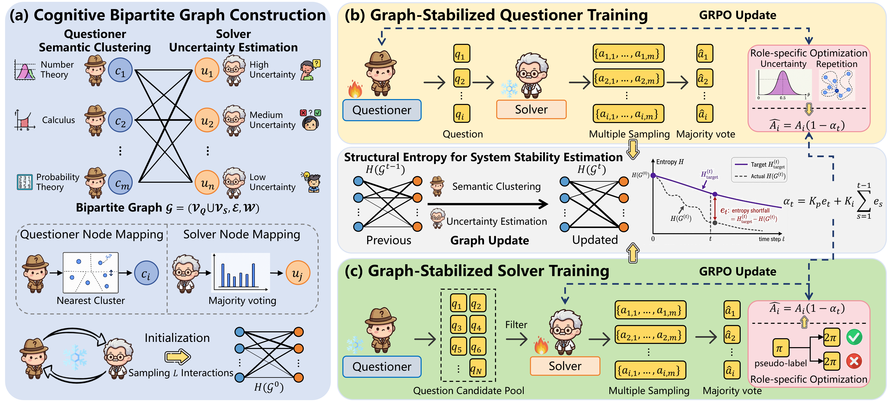

# S-BGM: Stable Self-Evolving LLMs via Cognitive Bipartite Graph Modeling

S-BGM is a self-evolving training framework for reasoning LLMs. It alternates between a
Questioner that generates new problems and a Solver that learns from those problems, while a
Cognitive Bipartite Graph tracks the global interaction topology between the two roles.

The key idea is to treat model collapse as graph concentration. Generated questions are mapped to
semantic clusters, Solver responses are mapped to uncertainty intervals, and recent interactions are
stored as weighted edges. Structural entropy over this graph provides a system-level stability signal
that scales GRPO advantages for both Questioner and Solver training.



## Method Overview

S-BGM contains four core components:

- Cognitive Bipartite Graph: `G=(V_Q union V_S, E, W)`, where `V_Q` contains semantic question
  states and `V_S` contains Solver uncertainty states.
- Semantic question mapping: generated questions are embedded with `Qwen/Qwen3-Embedding-0.6B`
  and assigned to the nearest K-means centroid.
- Solver uncertainty mapping: multiple Solver samples are majority-voted; the consensus ratio
  `p_hat` is discretized into uncertainty intervals.
- Structural-entropy stabilization: entropy is compared with a decayed target and converted to
  `alpha_t` by PI control; GRPO advantages are scaled by `1-alpha_t`.

Default paper-aligned parameters live in `examples/config.yaml`:

| Parameter | Default | Meaning |
| --- | ---: | --- |
| `semantic_clusters_m` | `100` | Question-side semantic states |
| `uncertainty_intervals_n` | `10` | Solver-side uncertainty states |
| `sliding_window_L` | `1024` | Recent interactions kept in the graph |
| `structural_entropy_K` | `2` | Structural entropy dimension |
| `entropy_decay_gamma` | `0.01` | Target entropy decay rate |
| `pi_kp` | `1.0` | Proportional gain |
| `pi_ki` | `0.01` | Integral gain |
| `solver_uncertainty_boundary_delta` | `0.20` | Solver data filter width |

## Repository Layout

```text
examples/
  config.yaml                         # Training and S-BGM hyperparameters
  format_prompt/                      # Questioner/Solver prompt templates
  reward_function/                    # Role-specific rewards
question_generate/                    # Candidate question generation
question_evaluate/                    # Majority-vote pseudo-labeling and filtering
scripts/
  main.sh                             # Multi-iteration co-evolution loop
  questioner_train.sh                 # Graph-stabilized Questioner training
  questioner_train_penalty.sh         # Default Questioner training entry
  solver_train.sh                     # Graph-stabilized Solver training
  sbgm_build_semantic_space.py        # Offline semantic cluster construction
verl/
  s_bgm/                              # Cognitive graph, entropy, semantic mapping, trainer hook
  trainer/                            # GRPO training loop with S-BGM advantage scaling
```

## Installation

```bash
cd S-BGM
pip install -r requirements.txt
```

Prepare runtime directories:

```bash
export STORAGE_PATH="/path/to/storage"
export HUGGINGFACENAME="your_hf_name"

mkdir -p \
  "$STORAGE_PATH/evaluation" \
  "$STORAGE_PATH/models" \
  "$STORAGE_PATH/generated_question" \
  "$STORAGE_PATH/temp_results" \
  "$STORAGE_PATH/sbgm/semantic_space" \
  "$STORAGE_PATH/sbgm/cognitive_graph"
```

Add credentials in `tokens.json`:

```json
{
  "huggingface": "hf_xxx",
  "wandb": "wandb_xxx"
}
```

## Build Semantic Centers

Before training, build the fixed Questioner-side semantic coordinate system from a math reference
corpus. The corpus may be one JSON file or a directory of JSON files. Supported question fields are
`question`, `problem`, `text`, `input`, and `prompt`.

```bash
python scripts/sbgm_build_semantic_space.py \
  --corpus /path/to/math_reference_questions_or_dir \
  --output_dir "$STORAGE_PATH/sbgm/semantic_space" \
  --embedding_model Qwen/Qwen3-Embedding-0.6B \
  --num_clusters 100 \
  --batch_size 64
```

The script writes:

```text
centroids.npy
labels.npy
embeddings.npy
question_metadata.json
index_to_question_id.json
cluster_stats.json
```

For vLLM embedding:

```bash
python scripts/sbgm_build_semantic_space.py \
  --corpus /path/to/math_reference_questions_or_dir \
  --output_dir "$STORAGE_PATH/sbgm/semantic_space" \
  --embedding_model Qwen/Qwen3-Embedding-0.6B \
  --num_clusters 100 \
  --use_vllm \
  --batch_size 128
```

## Run A Simple Experiment

The one-command loop alternates Questioner and Solver training for five iterations:

```bash
bash scripts/main.sh Qwen/Qwen3-4B-Base qwen3-4b
```

This script performs:

1. Train Questioner with uncertainty-centered reward and repetition penalty.
2. Generate candidate questions from the updated Questioner.
3. Use the Solver to produce multiple answers and compute majority-vote pseudo-labels.
4. Keep Solver training questions near the uncertainty boundary: `|p_hat - 0.5| <= 0.20`.
5. Train Solver with pseudo-label correctness reward.
6. Update the shared Cognitive Bipartite Graph during both role updates.
7. Compute structural entropy and scale GRPO advantages by `1-alpha_t`.

Generated artifacts are saved under:

```text
$STORAGE_PATH/models/
$STORAGE_PATH/datasets/
$STORAGE_PATH/generated_question/
$STORAGE_PATH/sbgm/cognitive_graph/state.json
```

## Manual Role Training

Train only the Questioner:

```bash
bash scripts/questioner_train_penalty.sh \
  Qwen/Qwen3-4B-Base \
  Qwen/Qwen3-4B-Base \
  qwen3-4b_questioner_v1
```

Train only the Solver after Questioner training:

```bash
bash scripts/solver_train.sh \
  Qwen/Qwen3-4B-Base \
  "$STORAGE_PATH/models/qwen3-4b_questioner_v1/global_step_5/actor/huggingface" \
  qwen3-4b_solver_v1
```

## Configuration Notes

S-BGM is enabled with:

```yaml
s_bgm:
  enabled: true
  role: questioner   # or solver
```

The same `graph_state_path` should be used by both roles so the system-level topology is shared
across co-evolution:

```yaml
s_bgm:
  centroids_path: ${STORAGE_PATH}/sbgm/semantic_space/centroids.npy
  graph_state_path: ${STORAGE_PATH}/sbgm/cognitive_graph/state.json
```

For CPU-only smoke tests, set `s_bgm.allow_hash_fallback=true` to bypass embedding-based semantic
assignment. This is useful for checking the trainer path, but it is not the paper-faithful setting.

## Evaluation

Evaluation scripts are kept in `evaluation/`. Typical use:

```bash
bash evaluation/evaluate.bash "$STORAGE_PATH/models/qwen3-4b_solver_v5/global_step_15/actor/huggingface"
```
